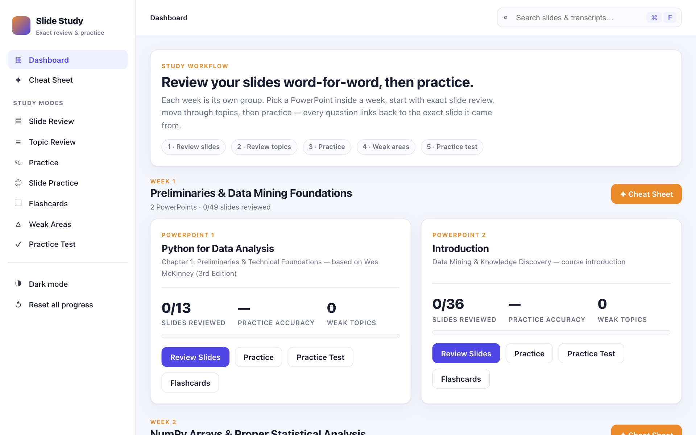
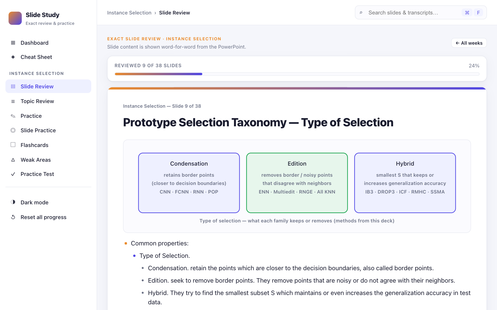
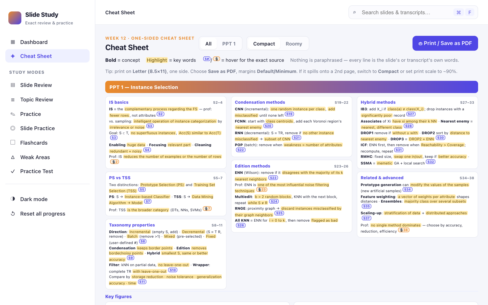

<div align="center">

# 🛠️ DataForge Study

**A single-file, offline study app for CSCI 521 — Data Cleaning & Preparation**

Every slide word-for-word · every lecture narrated · every question traced back to its slide


### 🌐 [**Open the live app →**](https://ch4ngs4n1ty.github.io/DataForge-Study/)

</div>



## Why

Lecture slides are dense, captions are messy, and generic flashcard apps paraphrase until the
wording no longer matches what shows up on the quiz. **DataForge Study** goes the other way:
it keeps the professor's slides exactly as written, pairs each slide with what was actually said
in lecture, and builds every practice question, flashcard and cheat-sheet line so that it points
back to a specific slide number you can check.

## Features

| | |
|---|---|
| 📑 **Exact slide review** | Slides transcribed word-for-word, typos and bullet levels included. Text that lives inside images (algorithm boxes, formulas, tables) is transcribed too. |
| 🎙️ **Lecture transcripts** | A faithful condensation of the lecture caption under every slide, noting caption mishearings, skipped slides and out-of-order coverage. |
| 🧭 **Topic review** | Each deck is grouped into topics so you can study a concept across several slides. |
| ✍️ **Practice** | Multiple choice, true/false, fill-in-the-blank, definition matching and short answer, all citing a slide. |
| 🎯 **Weak areas** | Tracks what you miss and resurfaces those topics. |
| 🧪 **Practice tests** | Mixed-type tests per deck with a scored results page. |
| 🃏 **Flashcards** | Know / practice confidence tracking per card. |
| 📄 **One-page cheat sheets** | Facts-first, one Letter page per week, printable. Hover any `S#` or 🎙 chip for the exact source quote. |
| 📊 **69 reconstructed diagrams** | Slide figures rebuilt as crisp SVG (pipelines, taxonomies, comparisons, benchmarks) that work in light and dark mode. |
| 🔎 **Quick find** | `⌘/Ctrl + F` or `/` searches every slide and transcript. |
| 🌗 **Dark mode** | Plus progress saved locally in your browser. |

<table>
<tr>
<td width="50%"></td>
<td width="50%"></td>
</tr>
<tr>
<td align="center"><sub>Slide review: the source text plus a reconstructed SVG</sub></td>
<td align="center"><sub>Cheat sheet: every line hover-cites its slide or the lecture</sub></td>
</tr>
</table>

## Quick start

```bash
git clone https://github.com/ch4ngs4n1ty/DataForge-Study.git
open DataForge-Study/study-app.html      # macOS — or just double-click the file
```

No install, no build step, no server, no internet. It's one HTML file with vanilla JS and CSS.
Progress is stored in your browser's `localStorage`.

## What's inside

| Week | Topic | Decks (slide cards) |
|---|---|---|
| 1 | Preliminaries & Data Mining Foundations | Python for Data Analysis (13) · Introduction (36) |
| 2 | NumPy Arrays & Proper Statistical Analysis | NumPy Basics (13) · Data Sets and Proper Statistical Analysis (18) |
| 3 | Using Statistical Tests to Compare Methods | Using Statistical Tests to Compare Methods (37) |
| 4 | pandas, Data Loading & Data Preparation | Getting Started with pandas (10) · Data Loading & Storage (10) · Data Preparation: Integration & Cleaning (15) |
| 5 | Plotting, Grouping & Data Transformation | Plotting & Visualization (10) · Data Aggregation & Grouping (9) · Data Preparation: Normalization & Transformation (27) |
| 6 | Dealing with Missing Values | Dealing with Missing Values (23) |
| 7 | Missing Values II — ML Imputation & Comparison | Dealing with Missing Values — ML Methods (29) |
| 8 | Dealing with Noisy Data | Dealing with Noisy Data (37) |
| 9 | Data Cleaning, Joining & Reshaping (pandas) | Data Cleaning & Preparation (11) · Data Wrangling: Join & Reshape (11) |
| 10 | Data Reduction & Time Series | Data Reduction (22) · Time Series Analysis (13) |
| 11 | Feature Selection | Feature Selection (34) |
| 12 | Instance Selection | Instance Selection (38) |

**Totals:** 20 decks · 416 slide cards · 319 narrated slides · 619 practice items · 347 flashcards · 69 diagrams

## How it's built

New weeks are added from that week's slides (`.pptx` / `.ppt` / `.pdf`) and the lecture caption,
following a fixed set of conventions:

- **Verbatim first.** Slide text is checked programmatically against the source text layer
  (python-pptx). Content that exists only as an image is transcribed and checked by eye, and the
  card says so.
- **Honest gaps.** Anything missing or cropped in the source (skipped slide numbers, cut-off
  tables, outline sections with no slides) is flagged on the card, never silently filled in.
- **Merges are noted.** Repeated outline and section-divider slides collapse into one card, with a
  card → deck-slide map so quiz citations still line up.
- **Every quote is verified.** Practice evidence and cheat-sheet hover quotes are machine-checked
  against the slide text or the raw caption before a week ships.
- **Render-checked.** SVG diagrams are tested for text overflow and overlap, every earlier week is
  reloaded to make sure nothing broke, and the cheat sheet's printed page count is confirmed.

## Project structure

```
DataForge-Study/
├── study-app.html      # the entire app: data, UI, diagrams (single file)
├── docs/               # README screenshots
└── README.md
```

Inside `study-app.html`, the content is plain data that's easy to extend:

| Object | Holds |
|---|---|
| `WEEKS` | week → deck grouping |
| `DECKS` | slide cards (`H` / `P` / `B` / `TBL` / `CODE` / `IMG` / `DG` blocks) + transcripts + topics |
| `BANK` | slide-cited practice questions |
| `FLASH` | flashcards |
| `CHEAT` | cheat-sheet sections with source quotes |
| `DIAGRAMS` | SVG diagram registry |

## Notes

Built for personal study in CSCI 521 at RIT. The slide content and lecture material belong to
their original authors and the course; this repository is private and not for redistribution.
